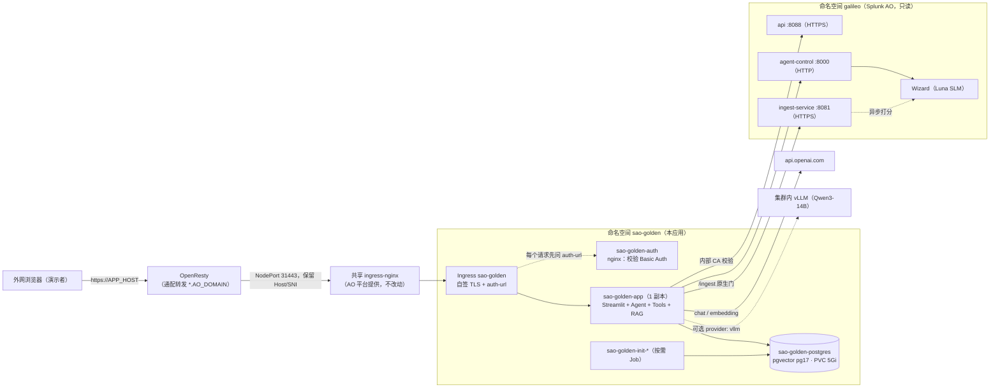

# Kubernetes / Splunk AO On-prem 部署与运维手册

本文写给管理员：说明 Golden Demo 如何部署到机房 Kubernetes、以同集群的 **Splunk AO On-prem** 为后端，以及日常启停、升级、回退、排障与演示前检查。逐条执行记录见 [records/k8s-onprem-record-20261121.md](records/k8s-onprem-record-20261121.md)；Mac 本机运行见 [README](../README.md)。

> 本仓库是 Public 仓库，文中环境相关的值一律用占位符：
>
> | 占位符 | 含义 | 示例 |
> | --- | --- | --- |
> | `<AO_DOMAIN>` | AO On-prem 的公网域名后缀 | `console.<AO_DOMAIN>` 为 AO Console |
> | `<APP_HOST>` | 本应用的公网主机名 | `golden.<AO_DOMAIN>` |
> | `<OPS_NODE>` | 执行 kubectl / helm 的集群节点；本仓库工作副本在 `/root/<WORKDIR>` | |
> | `<BUILD_HOST>` | 有 Docker + buildx 的镜像构建主机；工作副本在 `/root/<BUILD_WORKDIR>` | |
> | `<IMAGE>` | Docker Hub 公开镜像仓库 | `<dockerhub-user>/sao-golden` |
> | `<NODE_IP>` / `<PG_NODE>` | 任一节点 IP / PostgreSQL 固定调度的节点 | |
> | `<BASIC_AUTH_USER>` | Basic Auth 账号 | |

## 1. 架构与原理



要点：

- **独立应用**：Golden Demo 不是 AO 的组成部分，只是 AO 的使用者，并借用 AO 平台的 ingress-nginx 控制器和 `*.<AO_DOMAIN>` 域名入口。本应用的代码、配置、凭据、证书、账号、脚本都在本仓库、本应用工作目录和命名空间 `sao-golden` 中；AO 的仓库、工作目录和 `galileo` 命名空间里没有本应用的任何东西。
- **集群内只用 AO 内部服务地址**：`https://api.galileo.svc.cluster.local:8088`、`https://ingest-service.galileo.svc.cluster.local:8081`、`http://agent-control.galileo.svc.cluster.local:8000`。AO 内部 TLS 由 “Galileo Internal Root CA” 签发；部署脚本只读 ConfigMap `galileo/galileo-internal-ca-cert` 的公钥，复制成本命名空间的 ConfigMap `ao-internal-ca`。App Pod 的 initContainer 把它与系统 CA 合并为一个 bundle，并设置 `SSL_CERT_FILE` / `REQUESTS_CA_BUNDLE`（httpx、galileo-core、requests 都认，OpenAI 的公网证书照样受信）。`galileo_console_url` 只用于生成浏览器打开的链接。
- **Trace 走原生 JSON ingest 门**：SDK（`GalileoCallback` + `GalileoLogger`）把新 Trace 写到 `/ingest/traces/<project>`。集群内 `api` Service 不提供 `/ingest`，所以配置 `galileo_ingest_url` 指向 ingest-service；Trace/Span 更新与 session 调用仍走 api（与官方 Observe Request Flow 一致）。不需要改为 OTLP。本应用使用的是老一代 `galileo` SDK；它与新一代 `splunk-ao`（OTLP）的对比，以及 SaaS 与 On-prem 支持的接入接口，见 [README 6.4](../README.md#sdk-and-ingest)。
- **Basic Auth**：共享 ingress-nginx 控制器以只读根文件系统运行，`auth-type: basic` 注解无法在控制器内写 htpasswd 文件。因此本应用自带一个很小的认证服务 `sao-golden-auth`（nginx-unprivileged，读取 Secret `sao-golden-basic-auth`），Ingress 用 `nginx.ingress.kubernetes.io/auth-url` 让控制器对每个请求先做一次子请求：凭据正确返回 204 放行，否则返回 401 + `WWW-Authenticate: Basic`，浏览器弹出登录框。AO 的控制器不做任何改动。
- **对外发布**：OpenResty 对 `*.<AO_DOMAIN>` 通配转发到 ingress-nginx 的 NodePort 31443，所以集群里新建的 `<APP_HOST>` Ingress 会自动公网可达（无需 OpenResty 改动）。反过来，**在集群里新建任何 `*.<AO_DOMAIN>` Ingress 之前都要先确认认证已生效**。
- **单演示者**：Agent Control 初始化与当前 Project/Log Stream 是进程级状态，同一时间只支持一位演示者，App 固定 1 副本（`Recreate`）。
- **不拆微服务**：Agent、Tools、RAG 在同一进程内（Callback 父子关系与 Agent Control 桥接都依赖进程内上下文）；部署单元只有 App、PostgreSQL、认证服务和按需的数据初始化 Job。

| 对象（命名空间 `sao-golden`） | 说明 |
| --- | --- |
| Deployment `sao-golden-app` | 镜像 `<IMAGE>:<tag>`；非 root（10001）、只读根文件系统、`/tmp` `/home/app` `/data` 为 emptyDir；`automountServiceAccountToken: false`；探针 `/_stcore/health` |
| Deployment `sao-golden-auth` + ConfigMap | `nginxinc/nginx-unprivileged`（固定 digest），非 root，只读根文件系统 |
| StatefulSet `sao-golden-postgres` | `pgvector/pgvector:pg17`，PVC 5Gi，`nodeSelector` 固定到 `<PG_NODE>`（本地盘 StorageClass 会把 PVC 绑在节点上） |
| Ingress `sao-golden` | `ingressClassName: nginx`，TLS Secret `sao-golden-tls`，`auth-url`，读写超时 3600 s（Streamlit WebSocket） |
| ConfigMap `ao-internal-ca` | AO 内部 CA 公钥（只读复制） |
| Secret `sao-golden-app` | `secrets.toml` 去掉 `[k8s]` 表后的内容，挂载为容器内 `/app/.streamlit/secrets.toml` |
| Secret `sao-golden-postgres` / `sao-golden-basic-auth` / `sao-golden-tls` | PG 密码 / apr1 htpasswd / 自签证书（3 年） |

Helm values 里没有任何凭据：模板只按名称引用 Secret，因此 `helm history` / `helm get values` 不会泄露密钥。

## 2. 部署前人工准备（必须由人完成）

> 只列必须由人完成的事：网页登录、创建/输入密钥、搬运含密钥的文件。其余由部署脚本完成。只在编辑器 / `vi` 或隐藏输入提示中输入密钥，不要 `echo` / `cat`，也不要贴到聊天里。

1. **Docker Hub 令牌（在 `<BUILD_HOST>`）**：在 hub.docker.com 以镜像仓库所属账号登录 → Account settings → Personal access tokens → 新建（Read & Write，设到期日），复制令牌（只显示一次）。在 `<BUILD_HOST>` 执行：

   ```bash
   docker login -u <dockerhub-user>     # 在不回显的 Password: 处粘贴令牌
   chmod 600 /root/.docker/config.json
   ```

   令牌只存在构建主机上；集群拉取 Public 镜像不需要凭据，`<OPS_NODE>` 与 Git 都不需要它。镜像仓库在首次 `docker push` 时自动创建（默认 Public，推送后在 Docker Hub 确认）。

2. **AO 应用专用 API Key**：以管理员登录 `https://console.<AO_DOMAIN>` → API Keys → 新建，名称如 `golden-demo`，范围为**组织级**（不要限定项目，Agent Control 需要组织级 Key）。复制 Key。

3. **填写配置文件**：在本仓库工作目录准备集群版配置（文件名约定见 3.1），用编辑器填写 `galileo_api_key`、`openai_api_key`、`[k8s].basic_auth_password`（Basic Auth 账号 `<BASIC_AUTH_USER>` 的密码）。`postgres_password` 用随机值即可，例如在本机 `python3 -c 'import secrets;print(secrets.token_hex(16))'` 生成后粘贴。

4. **把集群版配置放到 `<OPS_NODE>`**：

   ```bash
   mkdir -p /root/<WORKDIR>/.streamlit && chmod 700 /root/<WORKDIR> /root/<WORKDIR>/.streamlit
   vi /root/<WORKDIR>/.streamlit/secrets.toml     # 粘贴集群版内容
   chmod 600 /root/<WORKDIR>/.streamlit/secrets.toml
   ```

   也可以用 JumpServer 的 File Manager 上传后改名。

5. **（可选）浏览器**：演示前在 Chrome 打开一次 `https://<APP_HOST>`，用 `<BASIC_AUTH_USER>` 登录 Basic Auth；另开标签页用演示账号登录 AO Console（账号由 AO 管理员邀请，与 Basic Auth 账号相互独立）。

## 3. 配置：唯一的 `secrets.toml`

### 3.1 文件约定

凭据与配置都只写在 `.streamlit/secrets.toml` 一个文件里，格式与 [`secrets.toml.example`](../.streamlit/secrets.toml.example) 一致。不同后端的版本按文件名保存在同一目录（都被 Git 忽略），当前使用的那个复制为 `secrets.toml`：

| 文件 | 用途 |
| --- | --- |
| `secrets.toml.splunkse` | SaaS（splunkse 租户） |
| `secrets.toml.imlab-onprem` | 笔记本经公网使用 On-prem |
| `secrets.toml.imlab-onprem-k8s` | 集群内使用；放到 `<OPS_NODE>` 后命名为 `secrets.toml` |

切换：`cp .streamlit/secrets.toml.<后端> .streamlit/secrets.toml`，然后重启 App（集群内则重跑第 4.2 节第 2、3 步）。

### 3.2 集群版的键

| 键 | 集群版取值 | 说明 |
| --- | --- | --- |
| `backend_profile` | `imlab-onprem` | On-prem profile：API 由 Console 地址推导或显式指定；Agent Control 头名默认 `Splunk-AO-API-Key`；Console 无租户路径 |
| `galileo_console_url` | `https://console.<AO_DOMAIN>` | **只用于浏览器链接**（Console 按钮、Trace/Experiment 深链） |
| `galileo_api_url` | `https://api.galileo.svc.cluster.local:8088` | SDK 与 REST 调用 |
| `galileo_ingest_url` | `https://ingest-service.galileo.svc.cluster.local:8081` | 原生 ingest 门（探测与写入） |
| `agent_control_url` | `http://agent-control.galileo.svc.cluster.local:8000` | Agent Control SDK |
| `agent_control_api_key_header` | `Splunk-AO-API-Key` | 头名（不是 Key）；`Galileo-API-Key` 也可 |
| `galileo_api_key` | 组织级 Key | 第 2 节第 2 步 |
| `openai_api_key` 等 | OpenAI | 默认聊天与 embedding |
| `vllm_base_url` / `vllm_default_chat_model` | 可选 | 集群内 OpenAI 兼容 vLLM（如 Qwen3-14B），见 README 3.5 |
| `postgres_host` | `sao-golden-postgres` | Helm release 名 + `-postgres` |
| `postgres_password` | 随机值 | 同时用于 PG Secret |
| `environment` | `k8s` | |

文件末尾的 **`[k8s]` 表**只由部署脚本读取，App 不读取；脚本把它从 App Secret 中去掉：

| `[k8s]` 键 | 示例 | 说明 |
| --- | --- | --- |
| `namespace` | `sao-golden` | 命名空间；Helm release 名默认同名（可加 `release`） |
| `app_host` | `golden.<AO_DOMAIN>` | Ingress 主机名与自签证书 CN/SAN |
| `ingress_class` | `nginx` | 共享 ingress-nginx 的 IngressClass |
| `image` | `<IMAGE>` | 镜像仓库（标签在部署时指定） |
| `postgres_node` | `<PG_NODE>` | PG 固定节点；避开磁盘紧张的节点 |
| `ao_ca_configmap` | `galileo/galileo-internal-ca-cert` | AO 内部 CA 公钥（`<命名空间>/<ConfigMap>`） |
| `basic_auth_user` / `basic_auth_password` | | Basic Auth 账号；同一组账号可在其他独立应用中沿用 |
| `ingress_controller_service`（可选） | `galileo/ingress-nginx-controller` | `40-verify.sh` 读取其 NodePort |

只检查键是否齐全（不显示值）：`python3 deploy/k8s/scripts/secrets_tool.py check`。

## 4. 安装（可完整手工复现）

### 4.1 构建镜像（`<BUILD_HOST>`）

```bash
cd /root/<BUILD_WORKDIR> && git pull --ff-only          # 工作区必须干净
tmux new -s sao-golden-build
bash deploy/k8s/build/build-image.sh all  <IMAGE>        # 构建 + 冒烟 + 镜像卫生扫描
bash deploy/k8s/build/build-image.sh push <IMAGE>        # 推送，打印 digest
```

- 标签为 `${VERSION:-1.0.0}-<git 短 SHA>`，部署只用这种不可变标签（chart 拒绝空标签和 `latest`）。
- `all` 会：`docker buildx build --platform linux/amd64`（标签 `org.opencontainers.image.title=sao-golden`）；镜像内 `uv pip check`；以只读根文件系统启动冒烟容器 + `pgvector/pgvector:pg17`，检查 `/_stcore/health`、首页、容器内单元测试与 PG 连接，结束后删除 `sao-golden-smoke-*` 容器、网络、卷；检查 `/app` 中没有 `.git`、`secrets.toml`、`.runtime`、`data` 等，`docker history` 没有凭据类参数，并对导出的 `/app` 运行 `scripts/check-public-hygiene.sh --path`。
- 构建主机上有其他业务时：脚本只创建和删除 `sao-golden-*` 对象，**不要**执行 `docker system prune` / `docker volume prune`。

### 4.2 部署（`<OPS_NODE>`）

```bash
cd /root/<WORKDIR> && git pull --ff-only
python3 deploy/k8s/scripts/secrets_tool.py check                 # 1) 键齐全
bash deploy/k8s/scripts/10-prepare-namespace.sh                  # 2) 命名空间、AO CA、TLS、Secret（幂等）
bash deploy/k8s/scripts/20-deploy.sh <version>-<sha>             # 3) helm upgrade --install（--wait）
bash deploy/k8s/scripts/30-init-data.sh                          # 4) 首次安装：建表 + 导入 + embedding（OpenAI 计费）
bash deploy/k8s/scripts/40-verify.sh                             # 5) 验证（应为 ALL PASS）
```

| 步骤 | 做什么 | 只读 / 写入范围 |
| --- | --- | --- |
| `10-prepare-namespace.sh` | 建命名空间（标签 `app.kubernetes.io/part-of=splunk-ao-golden-demo`）；复制 AO CA 公钥到 `ao-internal-ca`；生成自签 TLS（已存在则复用）；从 `secrets.toml` 生成 `sao-golden-postgres`、`sao-golden-app`（去掉 `[k8s]`）、`sao-golden-basic-auth`（`openssl passwd -apr1 -stdin`）。密钥只经管道，不上屏、不进命令行参数、不落盘 | 只写 `sao-golden`；对 `galileo` 只 `get` 一个 ConfigMap |
| `20-deploy.sh <tag>` | 从 `[k8s]` 表生成 `--set`，`helm upgrade --install sao-golden deploy/helm/splunk-ao-golden-demo --wait`；`secrets.toml` 内容的 sha256 写入 Pod 注解，配置变化会触发重建 | 只写 `sao-golden` |
| `30-init-data.sh [domain…]` | 用当前镜像渲染 `templates/init-job.yaml` 创建一次性 Job（不是 Helm hook，升级不会重跑），对 5 个行业执行 `helpers/setup_vectordb.py`；可重复执行 | 只写 `sao-golden` |
| `40-verify.sh` | Pod 就绪；Pod 内 `scripts/check_demo.py --in-cluster --live`（内部地址 + 内部 CA、Project/Stream、原生 ingest 门、Agent Control 注册、OpenAI、数据库）；经共享 ingress NodePort 检查无凭据 401、Basic Auth 200 | 对 `galileo` 只读 Service |

日志在 `/root/<WORKDIR>/.work/logs/`（被 Git 忽略）。长任务放 tmux。

### 4.3 外网与浏览器验证

```bash
curl -s -o /dev/null -w '%{http_code}\n' https://<APP_HOST>/      # 应为 401，且带 WWW-Authenticate: Basic
```

浏览器打开 `https://<APP_HOST>`，输入 Basic Auth 账号后应看到 “Online Healthcare Assistant”，侧栏显示 `Backend: imlab-onprem`、“Agent Control connected”，Console 按钮与 “View traces” 指向 `https://console.<AO_DOMAIN>`。

### 4.4 AO 侧一次性准备（在 AO 中，不在本应用中）

首次在某个 AO 上使用时，用 App 发一条消息会自动创建 Project / Log Stream；然后：

```bash
kubectl -n sao-golden exec deploy/sao-golden-app -c app -- python scripts/setup_demo_controls.py   # 3 条 Demo Control，SQL 启用
kubectl -n sao-golden exec deploy/sao-golden-app -c app -- python experiments/create_galileo_dataset.py healthcare
```

在 Console 的 Log Stream 上启用 Luna（SLM）指标（见 README 3.5），并核对 Control 列表。

## 5. 日常启停

```bash
kubectl -n sao-golden scale deploy/sao-golden-app --replicas=0     # 停止（对外返回 503；PG 与数据保留）
kubectl -n sao-golden scale deploy/sao-golden-app --replicas=1     # 启动
kubectl -n sao-golden get pods -o wide
```

PostgreSQL 一般不必停；需要时同样 `scale statefulset/sao-golden-postgres --replicas=0/1`（PVC 保留）。下一次 `20-deploy.sh` 会把副本数恢复为 1。

## 6. 升级与回退

1. 改代码 → 提交推送 → `<BUILD_HOST>` `git pull` → `build-image.sh all` → `push`，记录新标签与 digest。
2. `<OPS_NODE>`：`git pull --ff-only` → `bash deploy/k8s/scripts/20-deploy.sh <新标签>` → `40-verify.sh`。
3. 回退：`bash deploy/k8s/scripts/90-rollback.sh [revision]`（`helm rollback --wait`，数据与 Secret 不变）。`helm -n sao-golden history sao-golden` 查看版本。
4. **改动对外暴露或认证时**（Ingress 注解、认证服务配置）：先把 App 缩容到 0，确认无凭据请求返回 401 / 503 而不是 200，再放出 App。认证服务本身可以这样单独验证：

   ```bash
   (timeout 25 kubectl -n sao-golden port-forward svc/sao-golden-auth 18080:8080 >/dev/null 2>&1 &); sleep 3
   curl -s -o /dev/null -w '%{http_code}\n' http://127.0.0.1:18080/           # 401
   python3 deploy/k8s/scripts/secrets_tool.py curl-auth | curl -s -o /dev/null -w '%{http_code}\n' -K - http://127.0.0.1:18080/   # 204
   ```

彻底撤除（**破坏性，需要明确决定**；合成数据可重建，`secrets.toml` 保留，不影响 AO）：

```bash
helm -n sao-golden uninstall sao-golden && kubectl delete namespace sao-golden
```

## 7. 改 Basic Auth 密码、换 Key、证书续期

- **改 Basic Auth 密码 / 换 AO 或 OpenAI Key**：编辑 `/root/<WORKDIR>/.streamlit/secrets.toml` → `bash deploy/k8s/scripts/10-prepare-namespace.sh` → `bash deploy/k8s/scripts/20-deploy.sh <当前标签>`（配置校验和变化会滚动重启 App 与认证服务）。
- **证书**：`sao-golden-tls` 为自签证书，3 年有效（`kubectl -n sao-golden get secret sao-golden-tls -o jsonpath='{.data.tls\.crt}' | base64 -d | openssl x509 -noout -enddate`）。续期：`kubectl -n sao-golden delete secret sao-golden-tls` 后重跑 `10-prepare-namespace.sh`。OpenResty 到集群不校验后端证书；如果将来开启校验，需要为本应用签发受信证书。
- **AO 内部 CA 变化**（AO 重装、换 CA）：重跑 `10-prepare-namespace.sh` 更新 `ao-internal-ca`，再 `kubectl -n sao-golden rollout restart deploy/sao-golden-app`。

## 8. 数据重建

PostgreSQL 中只有可重建的合成数据（演示状态在 AO 中），不做定时备份。重建：`bash deploy/k8s/scripts/30-init-data.sh`（全部行业）或 `30-init-data.sh healthcare`（单个行业）。会重新计费 OpenAI embedding。

## 9. 演示前检查（约 5 分钟）

1. `bash deploy/k8s/scripts/40-verify.sh` → ALL PASS。
2. 外网 `curl https://<APP_HOST>/` → 401；浏览器登录后发一个 Lisinopril 问题。
3. Control 状态：`kubectl -n sao-golden exec deploy/sao-golden-app -c app -- python scripts/setup_demo_controls.py --bindings-only --enable sql`（标准演示：SQL 启用，PII / Injection 停用）。深入演示时按需 `--enable sql,pii` 或 `--enable sql,injection`，结束后恢复。
4. AO 状态：Wizard Pod Running（`kubectl -n galileo get pods | grep wizard`，只读），Console 可登录。
5. 同一时间只让一位演示者使用（单副本、进程级状态）。

## 10. 排障

| 现象 | 检查 / 处理 |
| --- | --- |
| 外网 `<APP_HOST>` 返回 404 | 集群 ingress 没有这个主机的规则：`kubectl -n sao-golden get ingress`；若集群日志里根本没有请求，OpenResty 未转发该主机名（需 OpenResty 团队把 `server_name` 改为通配或加入 `<APP_HOST>`） |
| 返回 503 | App 0 副本或未就绪；或 Ingress 注解解析失败（`kubectl -n sao-golden get events`） |
| 无凭据返回 200 | **认证失效，立即** `scale deploy/sao-golden-app --replicas=0`；检查 Ingress 是否有 `auth-url` 注解、`sao-golden-auth` 是否就绪；按第 6 节第 4 步单独验证认证服务 |
| 事件 `AnnotationParsingFailed … read-only file system` | 说明在用 `auth-type: basic`；共享控制器不支持，改用本 chart 的 `auth-url` 方式 |
| 登录后页面空白 / 一直 “Connecting” | Streamlit WebSocket（`/_stcore/stream`）：Ingress 超时注解、OpenResty 的 Upgrade 头 |
| Pod 内预检 AO 地址失败 / TLS 错误 | `kubectl -n sao-golden get cm ao-internal-ca`；Pod 环境变量 `SSL_CERT_FILE`；AO 服务名与端口是否变化（`kubectl -n galileo get svc api ingest-service agent-control`，只读）→ 改 `secrets.toml` 后重跑第 4.2 节第 2、3 步 |
| Trace 没写入 | Pod 内 `check_demo.py --in-cluster --live` 的 “SDK uses the native ingest door”；`kubectl -n galileo logs deploy/ingest-service`（只读）中应有来自 App Pod 的 `POST /ingest/traces/<project>` |
| “Agent Control not verified” | Key 必须是组织级；`agent_control_url` 与头名；Pod 内预检 “Agent Control agent registered” |
| 普通问题被 Prompt Injection 拦截 | 确认镜像包含“LLM 步骤 Control 输入只取最新用户消息”的版本（见 README 6.x）；阈值 0.80 |
| PVC Pending / PG 不调度 | `postgres_node` 写错或该节点不可调度；本地盘 StorageClass 的 PVC 固定在首次调度的节点 |
| 集群内问题与 AO 问题如何区分 | AO 的 `70-verify.sh` 全 PASS 且其他客户端正常 → 问题在本应用；本应用只读 AO 的 Service 与 CA ConfigMap，不改 AO |

## 11. 接入新的独立应用（如 bank）

按本次确立的模式：

1. 应用有**自己的**仓库、工作目录（含唯一的配置/凭据文件）、命名空间。
2. 在自己的命名空间建 Ingress（`ingressClassName: nginx`，主机名 `<name>.<AO_DOMAIN>`）、自己的 TLS Secret 与认证（可复用本 chart 的 `auth-proxy.yaml` 模式和同一组 Basic Auth 账号，账号存放在该应用自己的配置文件中）。**先确认认证生效，再放出后端**（OpenResty 通配转发，新主机名会立即公网可达）。
3. 作为 AO 客户端时，在集群内只用 AO 内部服务地址，只读复制 `galileo-internal-ca-cert`；使用应用专用的组织级 API Key。
4. AO 侧不保存应用的任何东西；在 AO 运维文档中只登记“已接入的应用清单”。
